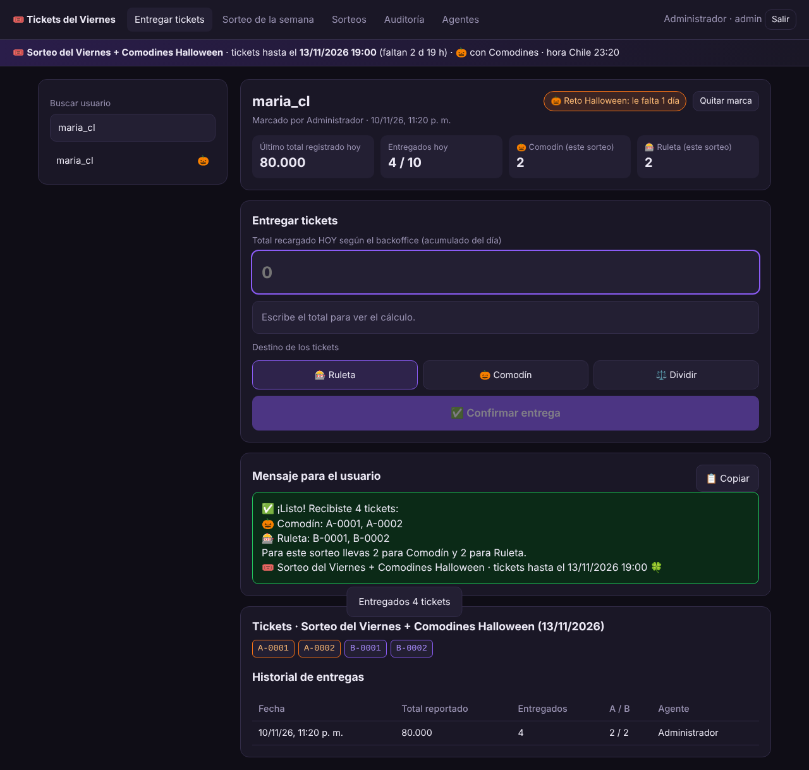

# Tickets del Sorteo: panel de Atención al Cliente

Fase 1 del sistema de sorteos: entrega de tickets en dos urnas (🎃 Comodines y 🎰 Ruleta).



## Instalar y arrancar

Requiere Node.js 22.13 o superior (recomendado: la versión LTS de https://nodejs.org).
No necesita Visual Studio ni compilar nada: usa la base de datos SQLite que ya viene incluida en Node.

> **Windows:** no instales el proyecto dentro de `C:\Windows\system32`. Antes de clonar, ejecuta `cd $HOME`.

```bash
npm install
npm start
```

En el primer inicio se crea el usuario `admin` (la contraseña aparece en la consola) y se abre automáticamente el
sorteo de esta semana **con Comodines Halloween**, con cierre el próximo sábado a las 18:00 (hora de Chile).
Para elegirla tú: `ADMIN_PASSWORD=miClave123 npm start`. Luego abre http://localhost:3000.

### Configuración (variables de entorno)

| Variable | Por defecto | Para qué |
|---|---|---|
| `TIMEZONE` | `America/Santiago` | Hora de Chile (con horario de verano automático). Define cuándo empieza el día y los cierres. |
| `PORT` | `3000` | Puerto del panel |
| `DB_PATH` | `data/sorteo.db` | Archivo de la base de datos SQLite |
| `BIG_AMOUNT` | `1000000` | Desde este total el agente debe escribir el monto dos veces |
| `ADMIN_PASSWORD` | aleatoria | Contraseña del admin en el primer inicio |

Las reglas fijas (20.000 por ticket, tope 10 por día, cierre sugerido sábado 18:00) están en `src/config.js`.

## Publicarlo en internet (Railway)

1. En https://railway.com inicia sesión con GitHub → **New Project** → **Deploy from GitHub repo** → `promo_comodines`.
2. En el servicio: **Variables** → agrega `ADMIN_PASSWORD` (tu clave) y `DB_PATH` = `/data/sorteo.db`.
3. Clic derecho en el servicio → **Attach Volume** → ruta de montaje `/data` (sin esto, los datos se borran en cada actualización).
4. **Settings → Networking → Generate Domain**: ese es el enlace para los agentes.

Cada `git push` a `main` vuelve a publicar el panel automáticamente; los datos del volumen se mantienen.
El login se bloquea 15 minutos tras 8 intentos fallidos por usuario.

## Flujo del agente

1. El usuario escribe pidiendo sus tickets.
2. El agente lo busca (o lo registra si es nuevo).
3. Copia el **total recargado HOY** que muestra el backoffice (el acumulado, no el último depósito).
4. El sistema calcula `min(10, floor(total / 20.000))` menos los ya entregados hoy y muestra cuántos entregar.
5. Si el usuario está marcado en el Reto Halloween, el agente elige Ruleta, Comodín o Dividir.
6. Confirma y copia el mensaje con los números de ticket para el usuario.

## Reglas que aplica el sistema

- **El total del día no puede bajar** respecto al último registrado (evita errores de tipeo).
- **Montos altos** (desde `BIG_AMOUNT`) deben escribirse dos veces.
- **Sin cambio, sin tickets:** si el total no cambió, no se entrega nada.
- **Tope de 10 tickets por usuario por día**, sumando las dos urnas.
- **Día por el servidor:** el día cambia a las 00:00 hora de Chile.
- **Entregas solo con sorteo abierto:** al llegar el cierre (por defecto sábado 18:00) las entregas **se bloquean solas**. El panel lo muestra en rojo y sugiere una respuesta para el usuario. Se reactivan cuando el admin anuncia un nuevo sorteo.
- **Comodines por sorteo:** cada sorteo indica si tiene Comodines. El primero (esta semana) los incluye; los siguientes se crean sin Comodines por defecto, y entonces todo va a Ruleta y las opciones de Halloween desaparecen del panel.
- **Numeración:** consecutiva y única por sorteo y por urna (`A-0001`, `B-0001`); se reinicia cada semana.
- **Reto Halloween:** solo los usuarios marcados ("le falta 1 día") pueden recibir tickets de Comodín. Cualquier agente puede marcar a un usuario; solo un admin puede quitar la marca.
- **Entregas simultáneas:** cada entrega es una transacción, así que dos agentes no pueden duplicar tickets.
- **Auditoría:** todo queda registrado (quién, cuándo, total, tickets) en la pestaña Auditoría (solo admin).

## Pestañas

- **Entregar tickets:** el flujo de arriba.
- **Sorteo de la semana:** elige un sorteo (actual o anteriores) para ver totales por urna, tickets y probabilidad de cada jugador, y descargar la lista completa en CSV para publicarla antes del sorteo.
- **Sorteos (admin):** anunciar un nuevo sorteo (nombre, fecha, cierre y si tiene Comodines), **Editar** (nombre, fecha y cierre) o cerrar ahora.
- **Anular entregas (admin):** en la ficha del usuario, botón **Anular** por entrega o **Anular todas sus entregas**. Se pide un motivo; los tickets salen del sorteo y del CSV, el tope del día se recalcula y todo queda en la auditoría. Los números anulados no se reutilizan.
- **Auditoría / Agentes:** solo para admin; crear y desactivar agentes.

## Pruebas

```bash
npm test
```

## Siguientes fases

2. Motor de sorteo verificable (hash publicado antes del stream, semilla pública, página verificadora).
3. Overlay OBS del bombo con físicas (Tiempo 1) conectado en tiempo real.
4. Ruleta del Tiempo 2 e inventario de premios con calculadora de boosts.
